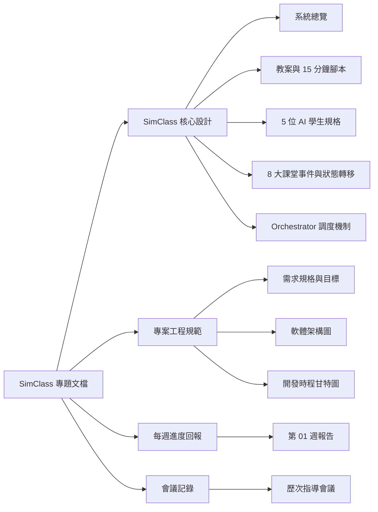

# SimClass - 國小數學微型教學 AI 學生模擬系統

歡迎查閱 **SimClass** 畢業專題的官方公開開發文檔與進度報告網站！本站專為展示專案開發進程、系統架構設計與會議紀錄所建置，方便指導教授與審查委員隨時掌握最新成果。

---

## 📌 專題基本資訊

| 項目 | 內容說明 |
| :--- | :--- |
| **專案名稱** | **SimClass - 國小數學微型教學 AI 學生模擬系統** |
| **教學科目與單元** | 國小數學（中年級）四則混合運算（含括號與先乘除後加減） |
| **核心技術** | 大語言模型 (LLM)、多代理人系統 (Multi-Agent System)、狀態機轉移規則 |
| **專題作者** | Ho-yu-chiao |
| **專案 Repo** | [GitHub: senior-project](https://github.com/Ho-yu-chiao/senior-project) |
| **公開文件網站** | [https://ho-yu-chiao.github.io/senior-project/](https://ho-yu-chiao.github.io/senior-project/) |
| **來源文件** | [Google Docs 專題共享文件](https://docs.google.com/document/d/12Y3odbI0IV6zJBWi_nhHnvx-t64decyDAo4Zbse3PqA/edit?usp=sharing) |

---

## 🎯 專案核心特色

1. **5 類異質性 AI 學生 (Heterogeneous Agent Cards)**：包含高成就搶答型 (A)、中程度觀望型 (B)、先加後乘迷思型 (C)、焦慮逃避型 (D) 與分心玩橡皮擦型 (E)。
2. **動態認知狀態機 (Knowledge & Classroom State Engine)**：追蹤掌握度 ($0 \sim 1$)、信心度與情緒，依教師引導語意進行狀態轉移。
3. **Orchestrator 智慧調度**：模擬真實 10–15 分鐘微型課堂互動節奏，避免多人搶話或死寂。

---

## 🗺️ 文檔章節導覽

### 專區快捷入口
- 📘 **[SimClass 系統總覽](simclass/overview.md)**：專案起源、解決之師培痛點與系統總體藍圖。
- 📝 **[微型教學教案與 15 分鐘腳本](simclass/pedagogy.md)**：三階段教學腳本（出題、對比、引導）。
- 👥 **[5 位 AI 學生 Agent 卡片](simclass/agents.md)**：5 位學生的完整屬性、行為特徵與 JSON 狀態結構。
- ⚙️ **[課堂事件與狀態轉移規則](simclass/events.md)**：8～12 個課堂挑戰事件與觸發規則。
- 🎭 **[Orchestrator 協調調度機制](simclass/orchestrator.md)**：多學生發言協調演算法與運作範例。
- 📈 **[每週開發進度匯報](progress/week01.md)**：每週向教授報告之里程碑與待辦清單。
- 🗣️ **[歷次指導會議紀錄](meetings/meeting-01.md)**：教授建議與行動清單追蹤。
