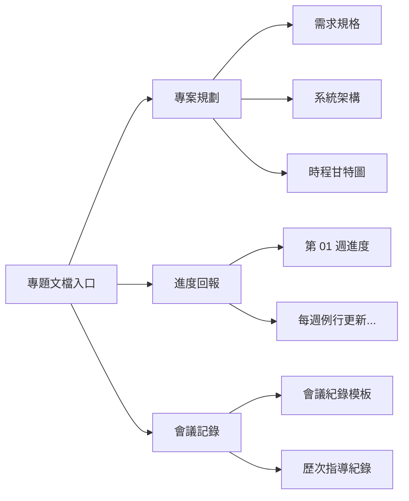

# 畢業專題開發文檔

歡迎查閱本專題的公開開發文檔與進度報告網站！本站專為展示專案開發進程、規格設計與會議紀錄所建置，方便指導教授與審查委員隨時掌握最新成果。

---

## 📌 專案基本資訊

| 項目 | 內容說明 |
| :--- | :--- |
| **專案名稱** | 智慧系統專題研究（可依實際題目修改） |
| **指導教授** | 指導教授姓名 |
| **開發成員** | 學生姓名（Ho-yu-chiao）與學號 |
| **專案 Repo** | [GitHub: senior-project](https://github.com/Ho-yu-chiao/senior-project) |
| **文檔網站** | [https://ho-yu-chiao.github.io/senior-project/](https://ho-yu-chiao.github.io/senior-project/) |
| **目前階段** | 需求分析與架構設計（第 1 階段） |

---

## 🚀 專案核心目標

1. **模組化系統開發**：建構高擴充性、高穩定度的核心架構。
2. **完整工程化流程**：落實 Git 版本控管、CI/CD 自動化發布與即時文件同步。
3. **成果可驗證性**：建立完善的測試案例與進度量化追蹤指標。

---

## 🗺️ 文檔章節導覽

本網站規劃了以下主要專區：

- **[專案規劃 - 需求與目標](spec/requirements.md)**：詳細定義專案研究動機、功能需求與非功能需求。
- **[專案規劃 - 系統架構](spec/architecture.md)**：包含系統流程圖、技術選型與模組互動架構。
- **[專案規劃 - 時程規劃](spec/roadmap.md)**：甘特圖與各階段里程碑追蹤。
- **[進度回報](progress/week01.md)**：各週工作成果、遭遇難題與下週 Action Items。
- **[會議記錄](meetings/template.md)**：與指導老師的面談重點、建議修正方向與代辦決議事項。

---

> 💡 **提示**：本文件將於每次團隊推動程式碼更新時，由 GitHub Actions 自動發布至最新版本。
