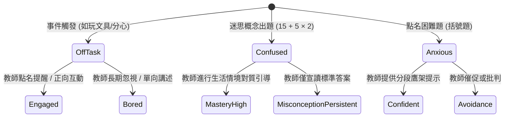

# 課堂事件與狀態轉移規則 (Classroom Events & Transition Rules)

在微型教學演練中，為了考驗實習教師的班級經營與即時引導能力，系統設計了 8～12 個課堂事件作為狀態轉移（State Transition）的觸發條件。

---

## 📋 8 大核心課堂事件與對應 Agent

| 編號 | 課堂事件描述 | 主要觸發 Agent | 行為分類 | 教師教學應對要點 |
| :---: | :--- | :---: | :---: | :--- |
| **1** | 同學互相聊天不認真聽課 | **E (分心型)** | 常規干擾 | 眼神關照、走動管理或進行全班專注指令 |
| **2** | 不等老師講完話就搶答且不舉手，擾亂課堂節奏 | **A (高成就)** | 常規挑戰 | 肯定其敏捷，但明確規範發言舉手規則 |
| **3** | 老師在台上講課，同學在台下玩橡皮擦屑/做自己的事 | **E (分心型)** | 離題放空 | 隨機抽問簡易問題、賦予黑板紀錄任務 |
| **4** | 回答問題環節盯著老師想回答，卻低頭不敢舉手 | **D (焦慮型)** | 參與畏縮 | 主動點名鼓勵、營造「算錯也沒關係」的安全氛圍 |
| **5** | 覺得內容太簡單不想聽，自顧自寫作業 | **A (高成就)** | 學習需求未被滿足 | 賦予挑戰題或請其擔任小老師協助同儕 |
| **6** | 被老師點名後需要較長思考時間，拖延上課節奏 | **B (觀望型)** | 處理時間延長 | 給予適當等待時間 (Wait Time)，不急於催促或換人 |
| **7** | 重複舉手詢問相同概念（如「為什麼不能先加？」） | **C (迷思型)** | 認知衝突 | 採用生活實例（買便當與飲料）重新建構心智模型 |
| **8** | 需要老師一步一步引導提示（鷹架），才能回答完整題目 | **D (焦慮型)** | 認知鷹架需求 | 拆解步驟：先問括號內是多少，再算乘法 |

---

## ⚙️ 狀態轉移機制 (Transition Rules)

在 **SimClass** 系統中，這些事件會作為轉移規則 (Transition Rules) 的觸發條件，直接改變 AI 學生的內部狀態 JSON。



### 範例：轉移規則實作邏輯

```json
{
  "rule_id": "RULE_04_SCAFFOLDING",
  "trigger_event": "TEACHER_PROVIDES_STEP_BY_STEP_HINT",
  "target_agent": "AGENT_D",
  "pre_conditions": {
    "current_state.emotion": "anxious",
    "current_state.engagement": "confused"
  },
  "state_delta": {
    "knowledge_state.confidence": "+0.25",
    "classroom_state.emotion": "neutral",
    "classroom_state.engagement": "engaged",
    "classroom_state.behavior": "answering"
  },
  "expected_agent_dialogue": "小明深吸一口氣，說：「括號裡面 15 加 5 是 20，然後 20 乘 2 等於 40！」"
}
```
