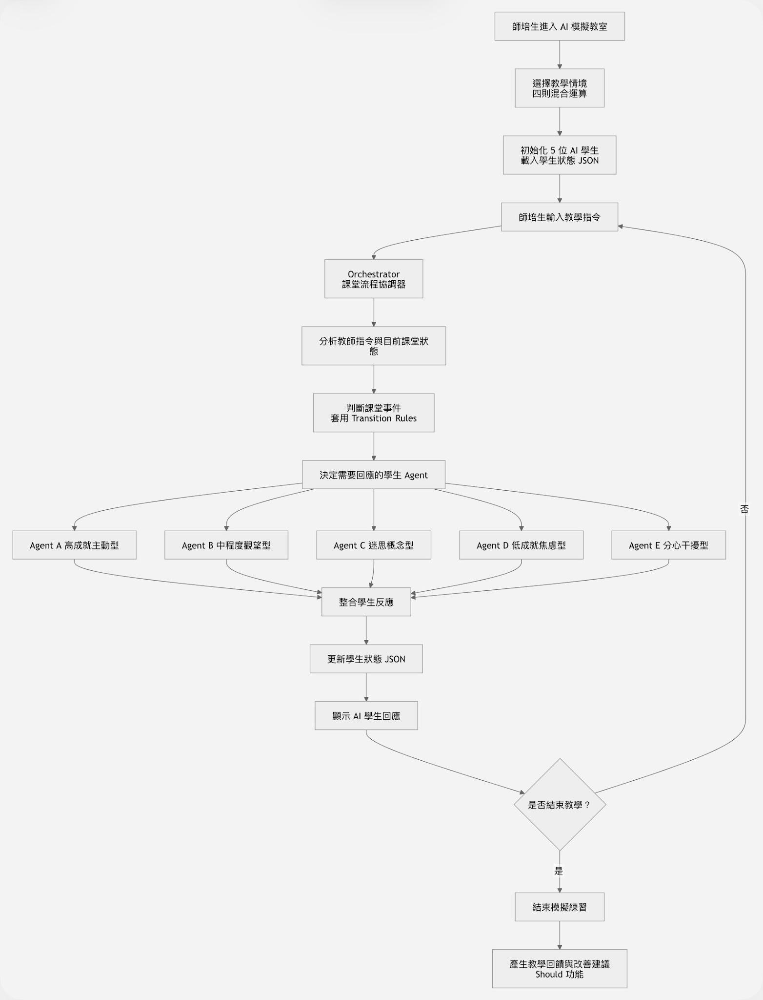
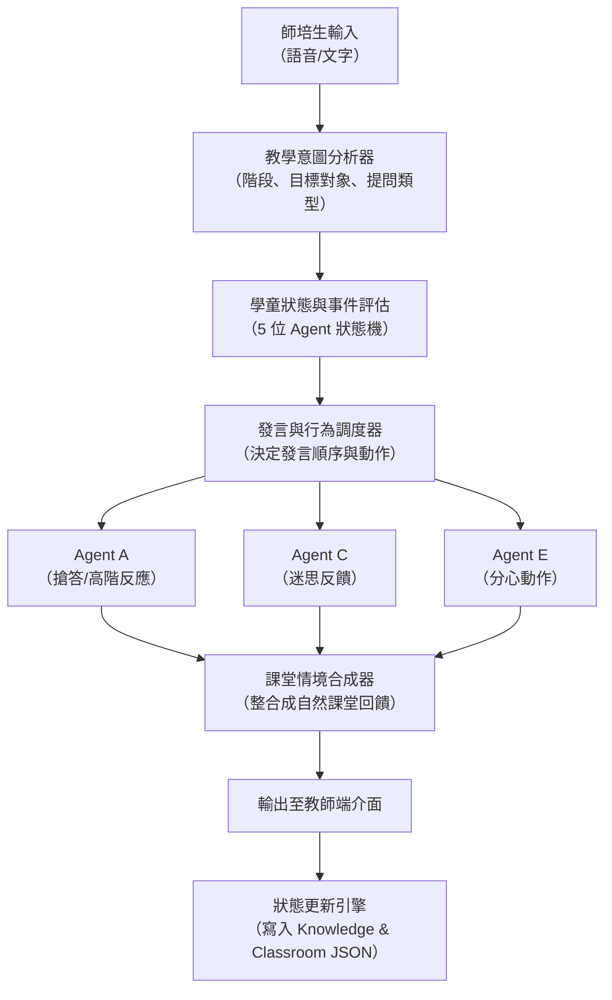

# Orchestrator 課堂協調調度機制

在多學童的虛擬教室中，不可能所有學生隨時同時說話。**Orchestrator** 扮演「虛擬課堂導演」的關鍵角色，負責分析教師的教學語句、當前課堂階段與 5 位學生的狀態，動態決定回應的優先級與發言權。

---

## 🖼️ Orchestrator 運作流程圖

---

## 👥 五位 Agent 的職責對照表

| Agent | 學生類型 | 模擬主要行為 | 典型課堂台詞/反應 |
| :---: | :--- | :--- | :--- |
| **A** | **高成就主動型** | 主動回答、搶答、覺得題目太簡單 | 「*老師！答案是 25，因為要先算乘法！*」 |
| **B** | **中程度觀望型** | 猶豫思索、需要較長思考時間 | 「*……（看著黑板，欲言又止）*」 |
| **C** | **迷思概念型** | 運算順序錯誤、重複詢問 | 「*不是 40 嗎？我先把 15+5 算完耶！*」 |
| **D** | **低成就焦慮型** | 不敢回答、眼神迴避、需要逐步引導 | 「*……我算不出來……好難。*」 |
| **E** | **分心干擾型** | 聊天、玩文具、不專心 | 「*（低頭玩橡皮擦屑，沒注意到黑板）*」 |

---

## 💡 Orchestrator 實際運作示範

### 1. 師培生輸入
> 🧑‍🏫 **實習教師**：「請問黑板上這題 $15 + 5 \times 2$ 的答案是多少？」

### 2. Orchestrator 判斷機制
* **教學階段**：階段一（引起動機與出題）
* **提問對象**：全班開放式提問
* **狀態分析**：
    * Agent A 信心高且搶答傾向高 $\rightarrow$ 觸發舉手/發言
    * Agent C 持有由左至右算之迷思 $\rightarrow$ 觸發質疑反應
    * Agent E 處於離題狀態 $\rightarrow$ 呈現分心行為
    * Agent B、D 保持沉默或觀望

### 3. 多代理人反應呈現
* 👦 **Agent A (高成就)**：「*老師！答案是 25，因為要先乘法！*」
* 🧒 **Agent C (迷思型)**：「*不是 40 嗎？我先把 $15 + 5$ 算完耶！*」
* 🧑 **Agent E (分心型)**：繼續低頭用尺推橡皮擦屑，完全沒有注意黑板。

### 4. 狀態更新 (State Transition)
若教師接下來能以**生活情境（買 15 元便當與兩杯 5 元飲料）**引導全班，系統將：
- 將 **Agent C** 的 `misconception` 狀態逐步轉移為 `false`，提升其 `mastery` 至 0.70。
- 若教師在此時點名 **Agent E**，將觸發驚慌行為並將其 `engagement` 從 `off_task` 拉回 `engaged`。
