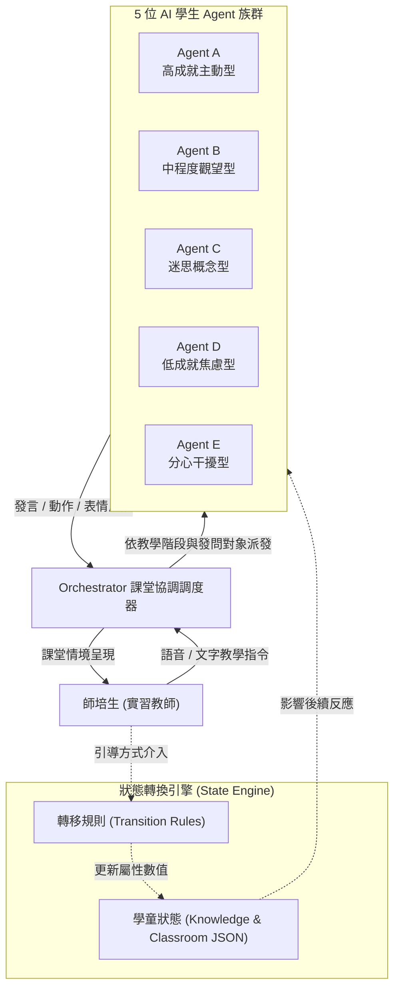

# SimClass 系統核心設計總覽

**SimClass** 是一個專為師資培育生（實習教師）設計的 **AI 虛擬微型教學模擬演練系統**。本系統透過大語言模型（LLM）驅動的多代理人架構（Multi-Agent System），在虛擬課堂中模擬出具備不同認知狀態、情感反應與行為模式的國小學生。

---

## 🎯 專題研究目標

傳統師資培育中的「微型教學（Microteaching）」常受限於真人學童取得不易、演練次數受限、以及同儕扮演學童時難以真實呈現迷思概念與行為干擾等限制。

**SimClass** 旨在透過生成式 AI 技術：
1. **重現多樣態學童反應**：模擬包含高成就、觀望、迷思概念、焦慮與分心等 5 種典型課堂學童行為。
2. **微型教學互動演練**：提供實習教師 10–15 分鐘的沉浸式教學情境，練習引起動機、提問引導（鷹架）與班級常規管理。
3. **即時動態認知狀態追蹤**：AI 學生的知識掌握度、信心度與情緒隨教師的教學引導策略產生動態狀態轉移（State Transition）。

---

## 🧩 核心架構模組

---

## 📚 系統五大組成要素

| 組成要素 | 說明 | 連結 |
| :--- | :--- | :--- |
| **教學設計與情境腳本** | 定義國小數學「整數四則混合運算」教學目標、板書題目與 3 階段微型教學腳本。 | [查看教案腳本](pedagogy.md) |
| **AI 學生 Agent 卡片** | 定義 5 位特質學童之知識掌握度 (Mastery)、信心度 (Confidence) 及課堂行為狀態。 | [查看 Agent 卡片](agents.md) |
| **課堂事件與轉移規則** | 定義 8～12 個課堂突發事件，以及教師回應如何觸發學童內部 JSON 狀態變更。 | [查看事件與規則](events.md) |
| **Orchestrator 調度機制** | 模擬真實課堂互動節奏，決定每次教師發言後由哪幾位學生產生反應。 | [查看調度機制](orchestrator.md) |
| **進度與會議追蹤** | 每週研發進度與教授指導紀錄公開追蹤。 | [查看進度報告](../progress/week01.md) |
