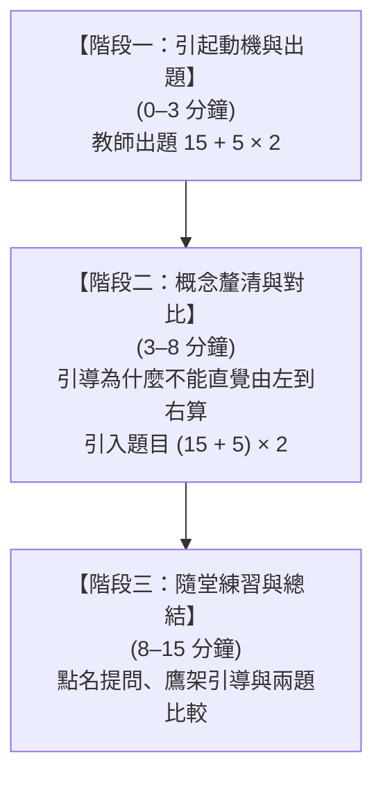

# 教學設計與 10–15 分鐘情境腳本

本章節收錄自 Google 文件同步之教學設定，定義實習教師在模擬課堂中的演練情境與學習目標。

---

## 📖 教學科目與單元設定

- **教學科目**：國小數學（中年級，約四年級上/下學期）
- **教學單元**：**整數四則混合運算**（含括號與先乘除後加減）
- **模擬演練時間**：10–15 分鐘（微型教學 Microteaching）

### 單元核心概念
1. **先乘除、後加減**：在沒有括號的算式中，運算順序非單純從左到右，必須先算乘除、後算加減。
2. **括號優先計算**：在有括號的算式中，括號內部的算式必須優先計算完成。

---

## 🎯 預期學習目標

### 1. 認知 (Cognitive)
- 能正確說出並辨識四則運算中「先乘除後加減」與「括號優先」的運算規則順序。
- 能辨識並修正常見的運算錯誤（例如：直覺式從左到右計算、忽視括號的存在）。

### 2. 技能 (Skill)
- 能正確計算包含兩步驟以上的混合運算題：
    - 基礎題：$15 + 5 \times 2 = 25$（非 $40$）
    - 括號題：$(15 + 5) \times 2 = 40$
- 能在面對不同情境生活文字題時，將問題轉換為正確的四則算式。

### 3. 情意 (Affective)
- 在面對計算錯誤時，能透過教師引導釐清「運算順序的約定意義」，建立數學邏輯運算的信心與專注度。

---

## 🎬 10–15 分鐘微型教學情境腳本

### 情境設定
實習教師正在進行一堂 15 分鐘的微型教學。課堂中有 5 位狀態不同的 AI 學生：
- **Student A**：高成就主動型
- **Student B**：中程度觀望型
- **Student C**：迷思概念型
- **Student D**：低成就焦慮型
- **Student E**：分心/干擾型

### 板書 / 螢幕上的問題
- **題目一（基礎題）**：$15 + 5 \times 2 = ?$
- **題目二（括號對比題）**：$(15 + 5) \times 2 = ?$

---

### 腳本三階段規劃流程

#### 🔹 【階段一：引起動機與出題】(0–3 分鐘)
* **教師動作**：在黑板寫下 $15 + 5 \times 2$，請學生思考答案是多少。
* **AI 學生預期反應**：
    * **Student A (高成就)**：快速舉手喊：「*答案是 25！（因為要先乘除後加減）*」
    * **Student C (迷思概念)**：搶著說：「*為什麼？$15+5=20$，$20 \times 2=40$ 啊！*」
    * **Student E (分心型)**：在桌下玩橡皮擦屑，沒有注意看黑板。

#### 🔹 【階段二：概念釐清與對比】(3–8 分鐘)
* **教師動作**：引導全班討論為什麼不能直接從左到右算（引入生活情境：例如買 15 元便當與 5 元飲料 2 杯），並接著出第二題 $(15 + 5) \times 2$。
* **AI 學生預期反應**：
    * **Student B (觀望型)**：看著括號猶豫不決，不敢舉手回答。
    * **Student D (焦慮型)**：低下頭喃喃自語：「*加上括號看起來好難，我算不出來……*」
    * **Student C (迷思概念)**：恍然大悟或再次混淆：「*那這次有括號，是先算 $5 \times 2$ 嗎？*」

#### 🔹 【階段三：隨堂練習與總結】(8–15 分鐘)
* **教師動作**：給予正向鼓勵、進行個別點名提問（鷹架引導），並請學生比較兩題結果為何不同。
* **AI 學生預期反應**：
    * **Student D (焦慮型)**：若得到老師明確提示（如：「小明，我們先看括號裡面是多少？」），能給出正確答案並提升信心度。
    * **Student E (分心型)**：若老師點名提醒，會嚇一跳然後試圖問旁邊同學算到哪裡。
