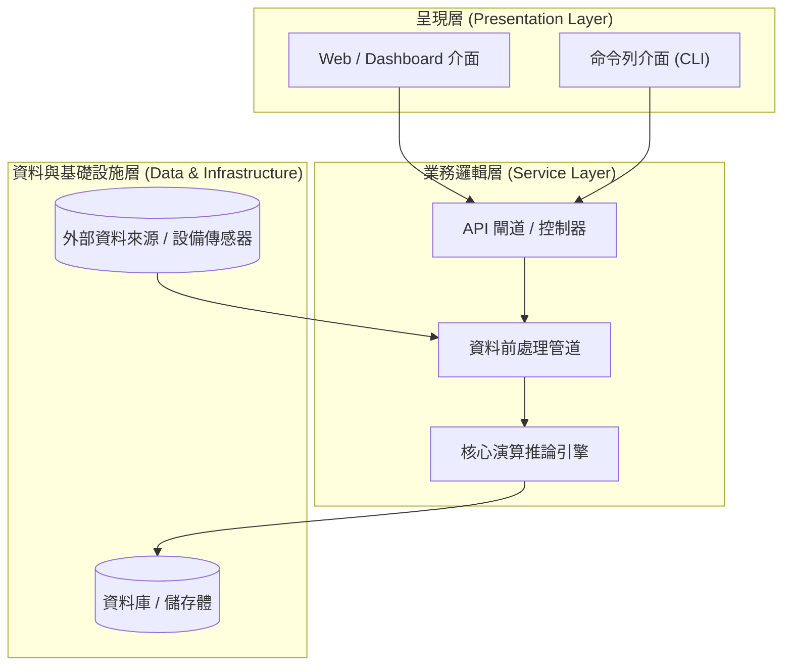
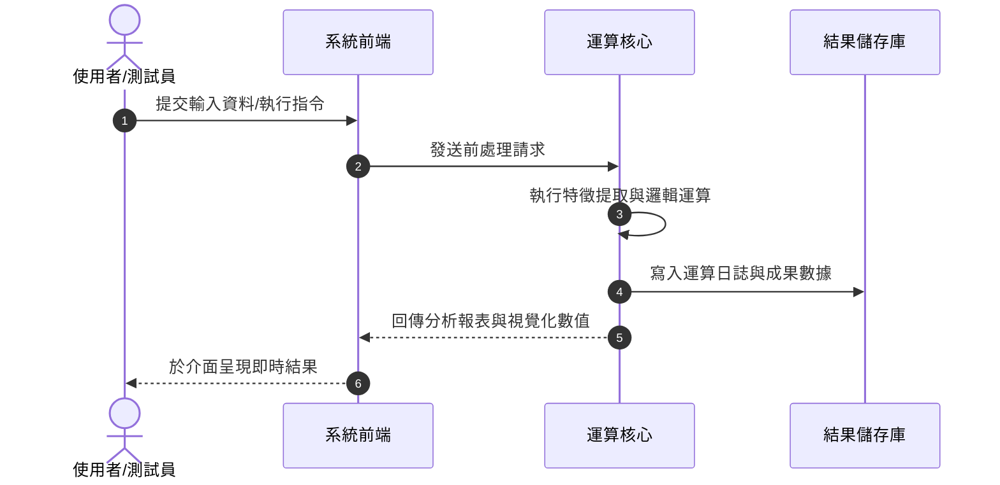

# 系統架構設計

本章節介紹系統的總體架構、技術選型以及模組間的資料流向。

---

## 1. 系統整體架構圖

本專案採用分層式架構設計，確保各模組職責清晰且具備高可維護性：

---

## 2. 技術選型 (Tech Stack)

| 領域 | 技術 / 工具 | 選型理由 |
| :--- | :--- | :--- |
| **程式語言** | Python 3.11+ | 擁有豐富的科學運算庫與良好的跨平台支援 |
| **文檔系統** | MkDocs Material | Markdown 原生支援、搜尋功能強大、便於學術成果展示 |
| **版本控管與 CI/CD** | Git / GitHub Actions | 自動化測試與文檔部署，落實現代軟體工程規範 |
| **環境管理** | Virtualenv / Poetry | 確保團隊成員與伺服器環境相依版本一致 |

---

## 3. 資料處理流程圖

