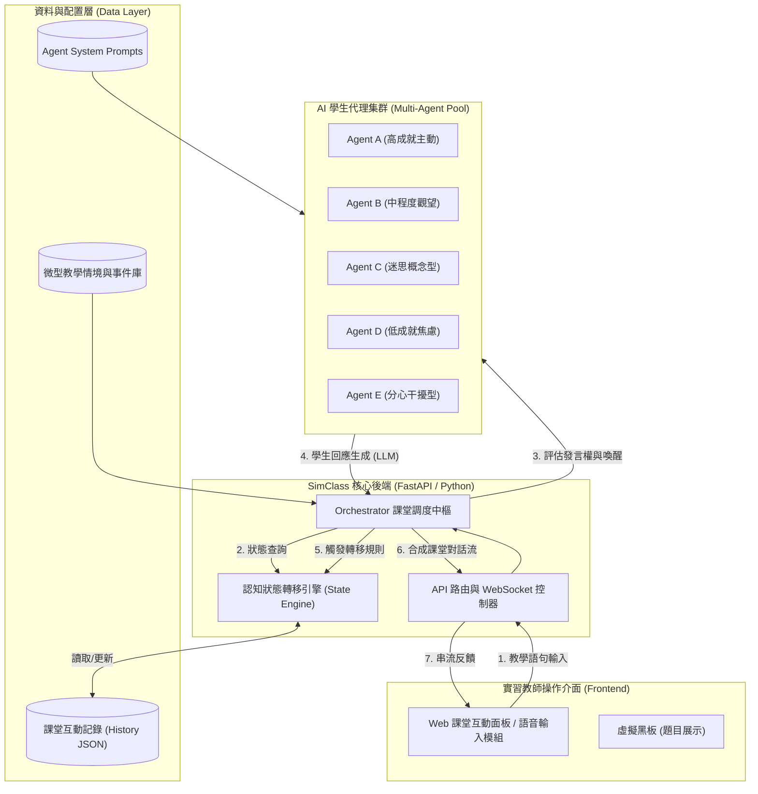
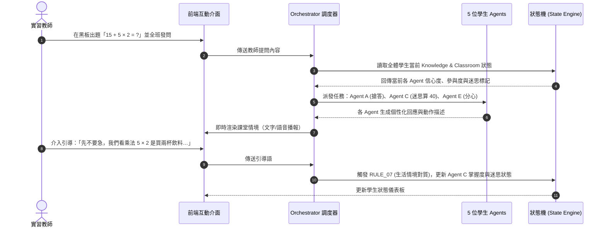

# 系統架構設計

本章節介紹 **SimClass** 系統的總體軟體架構、技術選型以及多代理人與狀態機之間的資料互動流。

---

## 1. 系統整體架構圖

本系統採用模組化與多代理人分層架構設計，確保各學生 Agent 的獨立運算與課堂 Orchestrator 的協調調度：

---

## 2. 技術選型 (Tech Stack)

| 領域 | 技術 / 工具 | 選型理由 |
| :--- | :--- | :--- |
| **大語言模型 (LLM)** | Google Gemini / OpenAI GPT-4o | 具備高精準語意分析、角色扮演穩定度與極低延遲推論 |
| **後端核心** | Python 3.11+, LangChain / LangGraph | 專為多代理人互動（Multi-Agent）與圖狀狀態機（State Graph）打造 |
| **Web 框架** | FastAPI + WebSockets | 支援即時雙向語音與文字串流，確保微型教學互動之即時感 |
| **文檔與報告平台** | MkDocs Material + GitHub Pages | 支援 Mermaid 圖表、LaTeX 數學式、全文搜尋與 GitHub CI/CD 自動部署 |
| **版本控管** | Git / GitHub Actions | 追蹤每一週之程式與教案演進，保證專案透明度 |

---

## 3. 課堂微型教學互動時序圖

