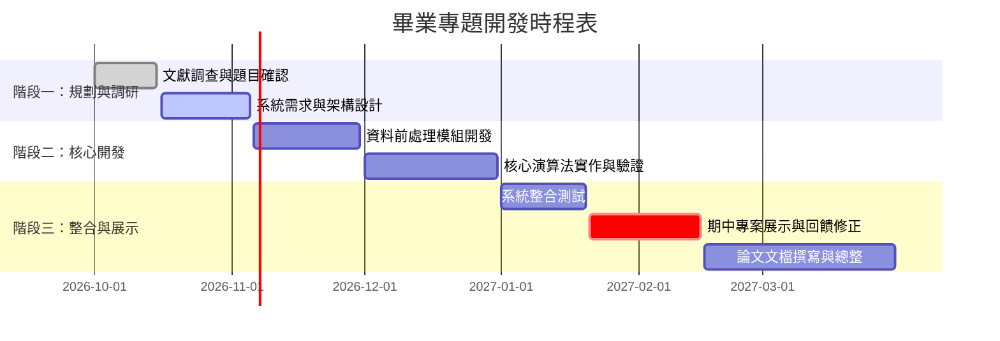

# 專案時程與里程碑 (Roadmap)

本章節紀錄專題開發之時程規劃、甘特圖與重要交付里程碑。

---

## 1. 專題甘特圖 (Gantt Chart)

---

## 2. 里程碑進度追蹤 (Milestones)

- [x] **Milestone 0: 專案初始化與架構確立** (完成日期: 2026-10-29)
    - 完成 GitHub 公開倉庫建置
    - 搭建 MkDocs Material 公開文檔平台
    - 配置 GitHub Actions 自動化部署流程
- [ ] **Milestone 1: 概念驗證原型 (PoC)**
    - 完成基礎輸入資料管線
    - 建立演算法效能評估基準
- [ ] **Milestone 2: 期中成果匯報與整合評測**
    - 系統核心模組端到端串接完畢
    - 完成期中書面報告與口頭簡報
- [ ] **Milestone 3: 最終系統驗收與論文產出**
    - 完成綜合性能測試與優化
    - 產出最終成果展演程式與展示投影片
